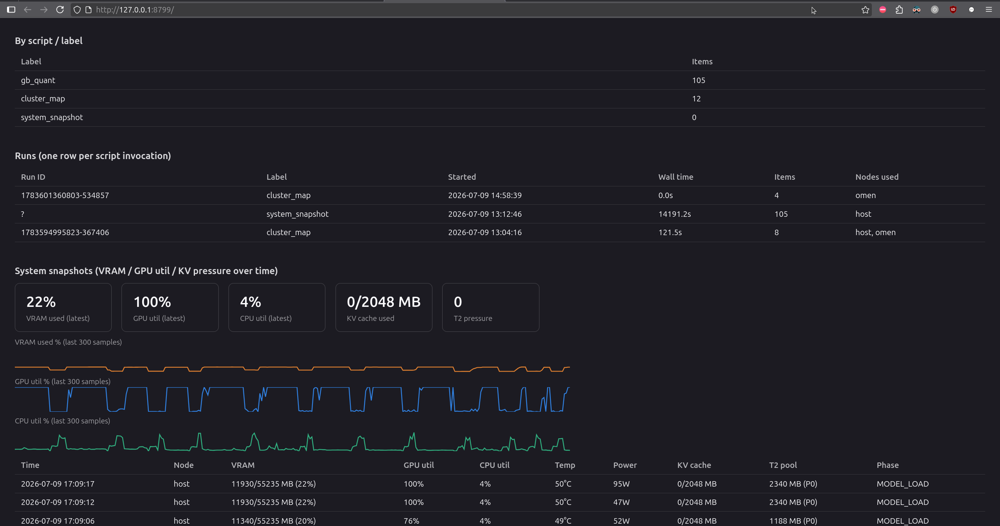
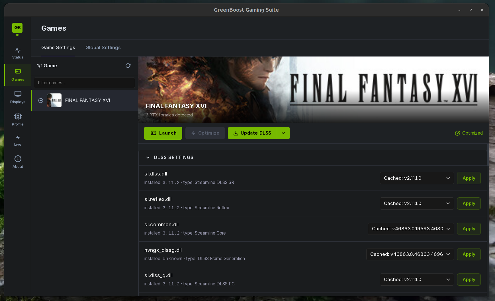

# GreenBoost Changelog

## v3.5 : 2026-10-30

**With hundreds of MCP tools connected, the model called `explain_ticker` with no arguments four times and the loop guard ended the turn.** The prompt carries only each tool's name once the schema budget is exceeded, so the model had no way to know `ticker` was required; the server's validation error was cut at 80 characters ("…explain_tickerArgume") and the retry was identical. `MCPRegistry.call_tool` now checks required arguments against the full schema it still holds, and when one is missing it answers with the parameter list (names, types, which are required) instead of calling the server; a server-side validation error gets the same list appended. Error lines in the terminal now use the terminal width instead of 80 characters. The bottom bar also names the active model, in cyan, right after `GPU: …`; it's dropped whole on a narrow terminal. Not measured against the live model yet: `explain NVDA` in `~/Dev/investing` is the check. The schema budget and prompt prefix are unchanged.

**Choosing a model in `/llamaserve` could cancel itself.** With a background `RAG refreshed` line printing while the Text-only / Vision / Cancel picker was open, the terminal's answer to a cursor-position query (`ESC [ 24;1 R`) reached the picker. `_getch` only understood arrow keys: it read the `ESC`, then the `[` and the `2`, gave up and returned a bare Escape, which the picker treats as Cancel, so "Cancelled, nothing started" appeared and the model switch was rolled back to the previous model. `_getch` now reads a whole escape sequence: arrows (both `ESC [ A` and `ESC O A` forms) still move, a lone Escape still cancels, and any other sequence (terminal replies, function keys, Alt+key) is swallowed whole and ignored. Four pty tests cover it. It doesn't stop the terminal from sending the reply; it stops the reply from being read as a key.

**greenboost-cli sent no sampling settings at all, so the model ran on whatever the server defaulted to.** The Qwen3.8 Distill card is explicit that this matters for code: a repeat penalty above 1.0 punishes the brackets and indentation code is made of and swaps `{` for `=`, and greedy decoding makes the model loop on long answers. Every chat request now carries the card's profile (temperature 0.6, top_p 0.95, top_k 20, min_p 0.05, repeat_penalty 1.0, no presence or frequency penalty) and holds repetition back with the DRY sampler instead (multiplier 0.8, base 1.75, allowed length 2; the penalty window is left at the server default, the whole context, because the card's "0" advice contradicts llama.cpp's documented meaning of 0 as off). Both request paths build it through one helper, `apply_request_tuning`, so they can't drift. Override one key with `settings["sampling"] = {"temperature": 0.2}`, or send nothing with `settings["sampling"] = False`. New `/effort low|medium|high|auto` sets the template's `reasoning_effort` while `/think on` is active, and `settings["preserve_thinking"]` forwards the template's history policy (its default prunes old reasoning). Limits: none of this has been measured for quality or speed yet; it needs the registered model and a GPU run, and the proxy forwards the extra fields untouched but llama-server ignores any it doesn't know.

**The Qwen3.8-35B-A3B decoded at ~54 tok/s instead of the 122 to 138 the GPU expert cache gives, because three separate things kept the cache from being planned.** The README promises 104 to 115 tok/s with the cache; the status line showed 31 to 63. The dataflux `moe_cache_plan` events said why and nothing flagged it: the last three serves were `cache_mib: 0, skip_reason: not_enough_room` at budgets of 9.47 and 8.93 GB with the recipe's `ubatch: 2048`, logged as status `ok`. The plan arithmetic reproduces the one serve that did get a cache exactly (9.97 GB free: 3,414 MiB), so the diagnosis is the arithmetic, not a guess. (1) The recipe's ubatch is charged linearly against the cache's room (1.6 GB at 2048), which at a real desktop's free VRAM leaves less than the 3 GB minimum; `serve()` now steps the ubatch down (2048, 1024, 512) to the largest that leaves room (`gb_moe_cache.plan_with_ubatch`), prints it ("ubatch 2048 -> 1024 so the GPU expert cache fits"), and records `ubatch` and `ubatch_requested`. (2) greenboost-cli kept about 1.5 GiB of VRAM after a `/rag-update`: `release_gpu_embedder()` emptied the allocator cache while a local variable and the module-level `_model` still referenced the weights, so it released the GPU embedder only on paper; that memory came straight out of the next serve's budget (the last logged serve ran right after one). Both references are dropped first now, with a weak-reference test proving the weights are gone before the cache is emptied. (3) `stop()` sent SIGTERM and returned, so a restart planned against a card the old server still held: free VRAM read 3.1 and 6.9 GB on a card that frees to 11.5, and `/llamaserve restart` waits one second. `stop()` now waits for the processes to exit and the free-VRAM reading to settle (escalating to SIGKILL after 20 s); measured 5.6 s, card fully free. Also: a skipped cache is now a warning with its cost and the fix, printed at serve time and logged as `warn`.

Measured on the real server (engine timings, median of 3 completions of 320 tokens, `bench_decode.py`), same session. Old configuration (cache off, `--n-cpu-moe 32`, MTP depth 4, ubatch 2048): **54.1 tok/s** (55.8, 54.1, 50.0), cold prefill 1,858 tok/s. Free card, new serve (cache 4,427 MiB, MTP depth 2, ubatch 2048): **138.2 tok/s** (141.2, 137.5, 138.2). Card holding 2 GiB like the owner's session (9.0 GB free): ubatch steps 2048 to 1024, cache 3,375 MiB, **122.3 tok/s** (122.3, 109.7, 127.4), re-run 117.9, cold prefill 1,369 tok/s. Forcing ubatch 512 at that budget gave 123.9 tok/s but only 936 tok/s prefill, which is why the largest ubatch that fits wins. The cost of the fix at that budget is about a quarter of cold prefill (1,858 to 1,369 tok/s) for 2.2 times the decode; cached turns re-prefill almost nothing, so decode is what a person waits on. Governed layer: `tok_s_decode` was the latest single sample (318.6 tok/s from a 32-token reply while real turns ran at 31 to 63) and is now token-weighted over the last 10 completions of 100+ tokens (75.5 on the same log); new metric `moe_cache_mib` and segment `moe_cache_skipped_no_room` in the `serve_throughput` route, with eval cases for them and for the two greenboost-cli metrics that had none. Limits: one box, one model, three runs each; the stressed case uses a 2 GiB holder process to reproduce the budget, not the owner's exact session; the CLI's own CUDA context (a few hundred MiB) still stays resident after GPU embedding; the root modules (`gb_moe_cache.py`, `gb_synapse.py`, `gb_synapse_backends.py`, `gb_semantics.py`) are installed files, so this needs a Full Install and a model restart. Check it with `gb semantics answer "why is decode slow"`.

**Three small things from the last screenshots.** `/mcp-servers` misaligned every row whose server name was over 18 characters (`greenboost-orchestrator`, `svg-animation-studio`): the padding was applied to text that already carried colour markup, so it counted the markup; the first column now sizes itself to the longest name and a test checks that the numbers line up. `ToolSearch` returned pretty-printed JSON (221 lines for one query); compact JSON is 26 to 32% smaller, about 770 to 940 tokens saved per call on real MCP tools, and the model reads it the same. And `/mcp-add --env KEY=VALUE` could leave a token in the input-history file, so it is scrubbed after saving exactly as `/huggingface-token` does (it stays in the terminal's scrollback, which the command says).

**Browser MCP servers looked broken: plan mode blocked every MCP tool, one server lived in another account's config, and the GPU label named a process.** (1) A screenshot showed `get_console_message` of chrome-devtools "Blocked by plan mode: ... not a read-only operation", three times, then the loop guard. Plan mode only knew its builtin read-only tools, so no MCP tool could ever run in `[PLAN]`, including the ones that declare `readOnlyHint: true` (the signal Claude Code honours: 8 of chrome-devtools' tools, all 19 of dataflux's, 13 of the orchestrator's). They run now; a tool that declares nothing stays blocked (plan mode is a safety boundary, so a name like `get_` is never trusted), with a small default allowlist for the read-only servers that declare nothing (semble, reranker, knowledge-rag and contextual-rag reads) and a `plan_mode_allow_mcp` setting for the rest; the block message says how. chrome-devtools itself was fine: connected, 30 tools, `list_pages` returned the open tab in 11.5 s (the first call attaches to Chrome). (2) `firefox-devtools` is configured only in two other Claude accounts, and a terminal without `CLAUDE_CONFIG_DIR` reads just `~/.claude.json` (12 servers, 11 after skipping this CLI), so GB-CLI never saw it, while charlotte, playwright, browsermcp, reranker and greenboost were missing for the same reason. New commands: `/mcp-add <name> [--env K=V] <command> [args...]` (or a URL), `/mcp-add <name>` alone to copy a server from any Claude config, `/mcp-import [--all | names]`, `/mcp-remove <name>`. Servers are kept in `~/.greenboost_cli/mcp.json` (0600, read between Claude's config and `.mcp.json`) and connected at once with no restart and a 90 s first-start allowance for an `npx` download; `/mcp-servers` now lists what else exists in your Claude configs and how to add it. Measured: firefox-devtools connected in 0.5 s with 49 tools. (3) The bottom bar showed `GPU: python3 1.5G`, which was this CLI's own process: it now shows `GPU: NVIDIA RTX 5070 12G` (name and size read from the driver) and appends another job only when it is a real one, never this CLI or its children, gb-synapse, or a bare interpreter name. Limits: options for `/mcp-add` go before the command (everything after it is the command's own arguments); a server that two accounts configure differently takes the first one found.

**`/rag-update` and `/rag-add` printed nothing until they finished, so a few minutes of work looked like a hang.** A screenshot showed the prompt sitting empty after `/rag-update` while the CLI process was actually using the GPU at 100%; the next command typed was queued behind it, which made it look dead. Counting the work first (read-only): that update was 88 changed files, 10,136 chunks, roughly 3 to 4 minutes on the GPU. The commands now say what they're doing from the first second ("scanning ... for changed files"), then "embedding: 10,136 chunks on the GPU…" (or "on the CPU (slower)…"), then a line every ~8 s with count, percentage and a time-left estimate, and "done". The estimate is weighted by characters, not by count: chunks are embedded shortest first (less padding), so the long ones come last and a count-based countdown would run optimistic and then stall. It says "estimating…" until the first slice is timed, because the rate depends on this machine and the chunk sizes (the repo forbids hardcoded hardware figures, and the measured rate ranged from 46 chunks/s on a 512-chunk sample to slower on long chunks). Same progress for `/rag-add`, `/rag-update --all` and `--project`; `/rag-reembed` already had it. Limits: while a command runs in the foreground the prompt is busy and what you type is queued, and there is no cancel for these commands yet (Ctrl+C is the way out; the index is only swapped at the very end, so an interrupted update changes nothing). If a token was typed on the command line it's visible in the screenshot and scrollback; revoke it and use the hidden prompt instead.

**Every RAG search parsed 449 MiB of JSON to score vectors that take 0.03 s, and the embedder's query instruction was the wrong one.** Profiled on the live 297,628-chunk index: `json.load` of `metadata.json` (every chunk's full text) was 0.85 s of a 1.1 s search and about 1.2 GB of transient RAM; the matrix product was 0.03 s. Each index generation now carries a compact index built once (at save time, or on first search for an older generation): per-chunk file/project/line ids, and the texts as one byte blob plus offsets, memory-mapped, so a search reads only the few chunks it returns. Scoped searches measured 1.1 s to 0.16 to 0.18 s; the compact files are 364 MiB of texts plus about 10 MiB of ids, per kept generation. A search no longer touches `metadata.json`, which a test proves by corrupting it. Separately, Qwen3-Embedding's own query prompt is about web search and measured no better than no instruction (top-1 0.79 vs 0.79 on 200 functions of this repo); a code-oriented instruction gave top-1 0.84 and MRR 0.892 vs 0.859, so searches now use "Given a question about a codebase or its documentation, retrieve the code or text that answers it", and skill matching uses its own ("retrieve the description of the skill that applies"). Only the query side changes, so the index you just built stays valid; `GB_EMBED_QUERY_PROMPT` overrides it (`none` = the model's own). Also: the default contextual-RAG reranker is now `cross-encoder/ettin-reranker-17m-v1` (MRR 0.69 against 0.65 for the old ms-marco model, at 15 ms per pair against 29; the 68M and 150M variants score 0.75 and 0.77 at 105 and 243 ms), the RAG scan skips lockfiles, minified files, source maps, `build-*`/`cmake-build*` output and `.mcp-cache` (about 14,000 chunks of the live index; the next `/rag-update` removes them without embedding anything), and the 16 MCP servers were measured at 2.7 GiB of RAM in total, no GPU memory, 2.2 s to connect and nothing left running after close.

**With 352 MCP tools, `ToolSearch` only worked if the model typed a phrase that appeared verbatim.** The model sees a trimmed list and finds the rest through `ToolSearch`, which required the whole query to be a substring of a tool's name or description: "search code semantically" matched nothing even though `mcp__semble__search` is described as "Instant code search". It now ranks word by word (words in the tool's name weigh 6, in its server's name 4, in its description 2, and the whole phrase still outranks loose matches), and accepts Claude Code's `select:mcp__a__x,mcp__b__y` form for exact tools; the tool's own description tells the model both forms. Also: `GB_MCP_EXCLUDE` (comma-separated names or patterns such as `forge-*,svg-*`) and `GB_MCP_ONLY` decide which configured servers are started at all, unlike `/mcp-off`, which connects them and only hides their schemas.

**A big re-index on the CPU would have frozen the CLI, and a long re-embed could run the card out of memory.** The new embedder falls back to the CPU when the GPU has no room, at ~2.3 s per 1,500-char chunk (measured): fine for a query or a few edited files, hours for thousands of chunks, and it also raised torch's thread count above the one thread the RAG auto-update deliberately uses (a background reindex once froze input and `/exit` for over a minute). A single call may now embed at most `GB_EMBED_CPU_MAX_CHUNKS` chunks on the CPU (default 300, 0 = no limit); beyond that it raises `EmbedDeferred` with the usual explanation (what happened, that nothing changed and search still works, how long the CPU would take, and the command to run once the card is free) and never touches a batch that goes to the GPU. Thread count is no longer raised above a caller's lower setting. Separately, a real `/rag-reembed` run climbed from 3.6 to 10.2 of 11.6 GiB because chunks are processed shortest first and the longest come last; the re-embed now frees the allocator's cache between checkpoints, halves the batch and retries on an out-of-memory error (it stays small for the rest of the run), and `scripts/rag_reembed.py` sets `PYTORCH_CUDA_ALLOC_CONF=expandable_segments:True`. Also: `/mcp-servers` said "advertised now: ~104,403 tokens per request" for 16 servers, which reads as a flooded context; it now shows what the prompt really carries after the context-window cap (and the full-schema figure only when it's much larger). Docs: `claude-code-parity.md` now lists everything that reads the same configuration Claude Code does.

**Esc and Ctrl-C did nothing while the model was reading the prompt, and a cancel before the request was sent was ignored.** The screen said "the model is still reading the prompt, so this lands when the first token arrives", and on a deep context that is minutes. Cancel only looked at the stream when a token came in. Two real causes, found with a fake model server that accepts a prompt and never answers: (1) the abort fired 7 s before the request even existed, because the first turn spends that long loading the embedder for skill matching and auto-RAG, and the request then went out anyway; (2) once a request is waiting, closing the HTTP client from another thread doesn't wake the thread blocked on it (and the SDK retries), so the connection is now shut down at the socket and then the client closed. Now a pending cancel stops the turn before any request is sent, and a cancel during prompt processing closes the request: measured with the real CLI, "(cancelled — session state restored)" appears 1.4 to 1.5 s after the key press (it never appeared before; 20 s and still "Thinking…"). The embedders the first turn needs are loaded in the background at startup, so the first turn doesn't wait on them (10.4 s to 7.5 s in a test that types immediately). The proxy now cancels its handler when the client disconnects (`run_server(..., handler_cancellation=True)`), which is what lets llama-server see the abort and stop reading the prompt; that part is tested against a fake upstream, not against the real engine, and needs the model server restarted to take effect. The socket walk uses private httpx/httpcore attributes, so `tests/test_cancel_abort.py` fails loudly if a library upgrade moves them.

**The HuggingFace "unauthenticated requests" warning said what the hub wants, not what to do here.** The text ("Please set a HF_TOKEN to enable higher rate limits...") is sent by the hub server as a response header and logged verbatim by huggingface_hub, so it couldn't be reproduced offline. greenboost-cli now replaces it, once per run, with a message in the usual order: HuggingFace is treating this machine as anonymous; downloads and checks run slower and can be refused for a while; models already on disk still load and nothing is lost; to fix it, type `/huggingface-token <your-token>` (a free read token from huggingface.co/settings/tokens). The new `/huggingface-token` command saves the token to `~/.cache/huggingface/token` (what sentence-transformers and `hf` read) and to gb-synapse's own `hf_token`, both 0600, plus `HF_TOKEN` for the running session; typed on its own it asks with the input hidden, with `clear` it removes every copy, and it never echoes the token back in full. A token typed after the command is a line in the input history, so that entry is scrubbed right after saving (it stays in the terminal's scrollback, which the command says). If a token is already set the warning is simply dropped. Limit: downloads run in other processes (`greenboost pull`, `hf download`) print their own warning, which this doesn't touch; saving the token fixes those too, because they read the same files. `scripts/rag_reembed.py` shows the same message with `export HF_TOKEN=...` as its instruction.

**`/exit` left the dock on screen, leaked `^[[1;1R` into the shell, and left the model loaded.** Reproduced in a real terminal emulator by making the terminal answer cursor queries 1.6 s late (the model busy, the window busy): the exit path painted a static copy of the dock, then waited up to ~3 s on the terminal's reply before clearing anything, so "Goodbye." and the dock sat on screen; the wait stopped at the first reply because its own barrier was another cursor query, so a reply was left behind and the shell printed it. Now the screen is cleared first and "Goodbye." is printed on the clean terminal, no static dock is painted during shutdown, and the wait uses a barrier with a distinct reply (`ESC[5n` answers `ESC[0n`), so when it returns every earlier reply has been read; a terminal that answers promptly pays nothing. Measured with the real CLI and 16 MCP servers: 0.8 s from `/exit` to the shell on a normal terminal, 2.3 to 3.8 s on terminals that answer 0.8 to 2.6 s late, clean screen and no stray text in every case. Exit also unloads the model now: it stops the gb-synapse server for the CLI's configured model and prints one line ("Unloaded <name>; its VRAM is free."), for `/exit`, `/quit` and Ctrl-D alike. Opt out with `/exit keep`, `GB_CLI_KEEP_MODEL=1` or `"unload_model_on_exit": false`; another model's server is never touched, and a server that doesn't stop within 20 s is reported rather than waited on. MCP servers are closed in parallel and as whole process groups (an `npx` wrapper ignored stdin closing and left its real server running). Tried and dropped: `PROMPT_TOOLKIT_NO_CPR=1` made late replies impossible but the dock stopped pinning to the last rows (`tests/test_dock_pty.py` caught it). Limits: a terminal that never answers `ESC[5n` costs the 3 s cap once, and I could not test unloading a real running model here (none was loaded); it is covered by tests against a fake server, and `gb semantics`/`greenboost synapse ps` will show whether the card was freed.

**Code search was quietly running on a 2019-era embedder, and it now runs on the best one that fits.** `jinaai/jina-embeddings-v2-base-code`, the configured embedder, can't load under transformers 5 (its remote code imports `find_pruneable_heads_and_indices`, which that release removed). The engine caught the error and fell back to `all-MiniLM-L6-v2` without a word, so every RAG and skill search ran on it; the live index (297,628 chunks, 27,210 files) was built with it. Measured on 200 functions of this repo (docstring to function body, CPU, differences under ~0.05 are noise): MiniLM top-1 0.52, MRR 0.66; `granite-embedding-97m-multilingual-r2` 0.70 / 0.80; the 311M Granite 0.77 / 0.84; `Qwen/Qwen3-Embedding-0.6B` 0.81 / 0.87, which is the new default (`GB_EMBED_MODEL` overrides). It needs ~1.2 GB and the served 35B leaves less than that free, so placement is split: searches, skill matching and small batches run on the CPU in float32 (87 to 96 ms per query with 10 threads; bfloat16 was 283 ms), and bulk indexing runs on the GPU only when it has room (weights x1.25 plus 10% of VRAM free) and hands the card back when the batch ends. `GB_EMBED_DEVICE=cpu|cuda` forces one side; the CPU path is a measured, owner-approved exception to the no-CPU-compute rule, for embeddings only. Queries now carry the model's own query prompt. A failed primary load is announced once with the reason instead of being silent. **The existing index isn't usable by the new model, and it keeps working in the meantime:** search embeds the query with whichever model built the index (MiniLM, on the CPU) until you run `/rag-reembed`, which re-embeds all chunks on the GPU from the text already in the store, checkpoints every 4,096 chunks so a Ctrl+C or crash resumes, writes a new generation and swaps atomically; it refuses, changing nothing, if the card has no room, because the CPU would need days at ~2 to 4 s per chunk. Not measured yet: the GPU re-embed time for 297k chunks (the card was in use; it will print an ETA). Skill matching had the same trap: its cached vectors weren't keyed by embedder, so after a switch the widths disagreed, the shape error was swallowed and skills silently stopped auto-loading; the key now includes the embedder and a mismatch rebuilds the vectors. `GB_RERANK_MODEL` selects the contextual-RAG reranker (`ettin-reranker-68m-v1` looked better on a small test; `ms-marco-MiniLM-L-6` stays until a larger one agrees).

**A passing 200-test run cost the model a whole page of context, and a failing one lost its reason.** Bash results were cut 50/50 head and tail at 30,000 characters (less on a small window). A long run that exits 0 with a recognised summary line (pytest `N passed`, cargo `test result: ok`, jest `Tests: N passed`, go `ok pkg 0.4s`) now comes back as that summary plus a "N lines collapsed" note; any failure word in the output, any non-zero exit and anything shorter than 60 lines is left whole. A failing command that still overflows keeps 25% head and 75% tail, because the traceback and the failed-test list are printed last. Limit: only those four runner formats are recognised, so other build tools still come back in full.

**greenboost-cli said "No MCP servers connected" on a machine with 16 configured.** It only read a `.mcp.json` found by walking up from the current directory, and every server on this box lives in Claude Code's own config (`~/.claude.json`, `$CLAUDE_CONFIG_DIR/.claude.json`, per-project entries). It now merges those with `.mcp.json` (later wins), skips its own server, expands `${VAR}`, and sets `GB_MCP_NO_MIRROR=1` when two or more greenboost-* servers are present so the same status tools aren't offered two or three times. The client itself was fragile in five ways that are fixed together: servers started in the wrong working directory (relative scripts in `.mcp.json` failed from any subfolder); one server that never answered blocked every other one; replies over ~200 KB were cut off and a big `tools/list` came back as "connected, 0 tools"; one entry without a `command` took all MCP down; and `-p` mode never connected at all (it does now; `GB_MCP_AUTOCONNECT=0` skips it for scripted calls that don't need MCP). Servers now connect in parallel with a per-server timeout (`GB_MCP_INIT_TIMEOUT`, 30 s), each registers its tools as it finishes, and a failure is kept with its reason. Requests a server sends to the client are answered now (`ping`, `roots/list` with the working directory, anything else with "not supported"); they used to be dropped, which leaves a server that waits on the reply stalled until its own timeout. Measured on this box from `/tmp` (no `.mcp.json` anywhere): 16 of 16 servers, 352 tools, 3.5 s. `/mcp-servers` lists failed servers with the reason, `/mcp-servers reconnect [name]` retries and `/mcp-servers log <name>` shows the server's last stderr lines. The browser servers' snapshot, network and console dumps are cut at 6,000 characters, because one of them can fill most of a small model's window. Not done: the legacy two-endpoint SSE transport (`"type": "sse"` is tried as streamable HTTP); and large dumps are truncated, not summarised by a sub-model. Check it with `gb semantics resolve cli_mcp_servers_connected`.

**WebSearch reported "No results found" when DuckDuckGo had refused it, and WebFetch died on 403 with no way forward.** `html.duckduckgo.com` answers this client with HTTP 202 and a "select all squares containing a duck" page; the parser found zero results and the tool logged success, so the failure was invisible in telemetry too. Search now tries `lite.duckduckgo.com` first (200, ten results in the live test), then the html endpoint, and a challenge comes back as `Error: web search backend unavailable (...)` with a pointer to a browser MCP tool. WebFetch sent `greenboost-cli/1 (+local)`, which Wikipedia refuses (403) while the same request with a contact URL gets 200; the User-Agent now names the project (override with `GB_WEBFETCH_UA`), 403 errors name the wall (`"Just a moment..." looks like a bot check`), and the headless-browser retry that used to need `GB_WEBFETCH_BROWSER=1` is on by default (`=0` turns it off). That retry also used to hand a Cloudflare challenge page back as if it were the page; it now treats a 403 from the browser as a failure. Two limits: the browser retry runs the page's own JavaScript and can't check redirects hop by hop, which is why it was opt-in before; and Cloudflare-protected sites are hit and miss (Stack Overflow loaded in the last live run after about a minute of retries, and 403'd for the earlier investigation). The WebFetch `prompt` argument now works on pages over 6,000 characters: it keeps the blocks that mention the prompt's words (plus the page opening) and says how much it dropped; that is keyword extraction, not a model summary, so a page that never uses the prompt's wording falls back to its start. `gb semantics resolve cli_web_tool_error_pct` now reads real failures; its old `result_chars` signal is listed under `never_use`.

**greenboost-cli couldn't see the skills and agents Claude Code uses.** Skills were read from `~/.claude/skills` and the account folders only; project `.claude/skills` and installed plugins (named `plugin:skill`, e.g. `flux-best-practices:bfl-api`) were skipped, and the model never saw a list, it had to call `Skill()` blind. Discovery now follows Claude Code's precedence (project, active account, other accounts, global, plugins), and a bounded index (3,000 characters, identical turn to turn) is part of the static system prompt, ordered so skills that mention the project's stack (Cargo.toml, pyproject.toml, package.json, `.cu` files and a few others) come first; ranking only, no skill is hidden by it. In this repo the index now opens with `cuda`, `cuda-kernels` and `greenboost`. Matched skill bodies used to be appended to the system prompt, so a skill matching on one turn and not the next changed the first chunk and threw away the cached prefix behind it, tool schemas included; they now go in front of the user turn and are injected once per session. Agents in `.claude/agents`, `$CLAUDE_CONFIG_DIR/agents` and `~/.claude/agents` are available to Delegate after the greenboost folders (a Claude `model:` line is ignored: there's one local model), and `subagent_type` is accepted as an alias of `agent`, an unknown name running a general delegate. An older test asserted `.claude/agents` was deliberately not searched; it now pins the new order instead.

**`gb semantics resolve tok_s_decode` reported 318 tok/s while real turns ran at 31 to 63.** The metric returned the latest `tok_s_measured` sample, and a 32-token reply is a speculative-decoding burst: MTP accepts several tokens per step on easy text, so a short reply measured 318.6 tok/s while a 399-token reply on the same server measured 58. It now returns the token-weighted rate over the last 10 completions of at least 100 tokens, falls back to the median of the last 10 samples when none is that long (and says so in `raw_source`), and only then to the latest. Short replies still count in the event log; they just don't speak for the server any more. Check: `gb semantics resolve tok_s_decode --json`.

**Adding an MCP server meant hand-editing a JSON file the CLI then couldn't reload.** greenboost-cli now has `/mcp-add <name> <command or url>` (saves the server and connects it in the background, so the prompt doesn't freeze while a first-start `npx` downloads; it reports tool count and prompt-token cost when done, or the reason it didn't connect), `/mcp-import` (lists the servers in your Claude Code configs and copies the ones you pick) and `/mcp-remove <name>` (removes a server this CLI added; a server that comes from Claude Code's own config isn't edited, so it's gone for the session and loads again next start, unless you `export GB_MCP_EXCLUDE=<name>`). A server that is saved but fails to connect stays saved: `/mcp-servers log <name>` shows what it wrote and `/mcp-servers reconnect <name>` retries. Governed over MCP as `cli_mcp_servers_connected` (latest attempt per server, so a reconnect isn't counted twice and a server that failed later isn't still "connected"), with the `cli_mcp_none_connected` segment; web tool health is `cli_web_tool_error_pct`.
**Uninstall now removes everything v3.5 added; the new facts are visible over MCP and in telemetry; `greenboost doctor` checks the toolchain.** (1) `install_module.sh --uninstall` removed a 13-name subset of the Python modules and knew nothing of the expert-cache engine; it now derives its list from the full installer's `_py_files` (plus the checkout's `gb_*.py`) and removes `synapse-moecache`, `src-moecache` and the engine choice; `do_purge` removes `src-moecache` on a true uninstall; `check_installer_parity.py` fails on a future miss. (2) `synapse_status`/`synapse_serve`/`greenboost_overview` carry an `engine` block (active engine, version, `--moe-cache-mib` support, last cache size, MTP on/off and why); new read-only MCP tool `gpu_advice` (per-GPU recommendations with evidence and confidence). (3) New dataflux kinds `moe_cache_plan`, `engine_runtime_check`, `sdpa_backend`, `compile_decision`, `quant_conv_result` (group `tuning`), and `dataflux_critic` rules that name the fix. (4) `gb_doctor.py`: CUDA runtime vs nvcc, shim rebind patch (build marker `GB-MARKER cudart-rebind-force=1`), expert-cache engine, THP/T2 alignment, root helper, cli-venv shadow, each with a one-line fix. (5) Opt-in `GB_SYNAPSE_CPU_PIN=1|auto` (`gb_cpu_pin.py`): one llama.cpp thread per physical P-core with `-C` and `--cpu-strict`, derived from sysfs, off until its A/B is run. (6) THP research and a one-owner-per-knob proposal, known-issues entries marked resolved. Details, proofs and the A/B recipes: `workflow/round2-improvements.md`.


**The GPU expert cache could run the card out of memory.** The first real `greenboost-cli` request after a load crashed the engine with `CUDA error: out of memory`: the cache was sized with 11% safety, and the desktop had grown by about 0.5 GB since. The safety margin is now 16% (`GB_MOE_CACHE_SAFETY_FRAC`). Cost: the cache is about 3.1 GB instead of 3.5 GB and decode stays at 108-113 tok/s (a 2.6 GB cache would give 98). Three concurrent requests up to 12,000 tokens each no longer fail.

**`/exit` left `^[[1;1R` on the prompt line and the dock on screen.** A terminal that answered the cursor-position query after the CLI had turned echo back on printed the reply as text. The cursor query now keeps echo off when it times out (and waits 0.8 s), and `restore_terminal()` swallows late replies with a marker query before it turns echo on. Regression tests: `tests/test_exit_no_cursor_reply_echo.py`.

**One thread per P-core is opt-in, measured and left off.** `GB_SYNAPSE_CPU_PIN=1` serves with `-t 8 -C <mask> --cpu-strict 1`. Layer-split decode gained about 8%, but through the expert cache plus MTP (the shipped path) it did not (110 and 92 tok/s against 116 and 103), so it stays off. Running the CPU experts in ordinary memory was measured at -3% and dropped. Numbers: `workflow/round2-improvements.md`.

**greenboost-cli starts fresh and stays open.** (1) A new start no longer restores the last conversation: resume is explicit (`-c/--continue`, `-r/--resume` to pick, `/resume`, or `"resume_last_session": true` in settings, default off). If an older session exists a dim line says so (`Previous session available: /resume (105 messages, 3h ago)`); session files stay on disk. Auto-answer and a persisted accept-all/autonomous permission mode reset on every start unless passed (`--accept-all`). (2) `greenboost-cli /llamaserve load` was sent to the model as chat and, because any argv prompt was a one-shot, the process exited when that turn ended. A slash command in argv now runs as a command, then the REPL stays open (`--once` runs it and exits). (3) The permission card cut `Run: for i in $(seq 1 40); ...` at the first `(` and printed `Run: for i in $ · $i = $((i))`; the command is now shown verbatim (control and ESC bytes neutralised, newline as a return sign, wrapped by display width, ellipsis plus a "View full command" choice when long). Tests: `tests/test_fresh_start_and_permission_card.py`.

**The shim said it was rebinding onto the right CUDA runtime and did nothing.** With `GREENBOOST_CUDART_PATH` pointing at a CUDA 13 library inside a process that links CUDA 12 (the ai-forge "mesh" env: torch 2.7+cu128 next to a stray cu13 wheel), the shim printed "Rebinding onto the app's own libcudart" and then kept calling the cu13 library for every runtime function. `cudaGetDeviceProperties` came back in the cu13 struct layout, torch read the SM count as 0 (SIGFPE in the RNG, or fp16 convolutions that returned NaN and became a black upscaled image). Cause: `gb_cudart_resolve_syms()` was made fill-if-NULL on 2026-07-31, and the override path had already filled every pointer, so the rebind was a no-op. Fixed in the shim copy as `patches/shim-cudart-rebind-force.patch` (the rebind now forces the app's library; needs `git apply`, `make shim` and a root install), and at the source of the bad path: ai-forge's `_find_cudart_path` now prefers the cudart whose major matches the env's torch. Real-ESRGAN fp16 under the shim: NaN before, 32.89 dB against bicubic after (`tools/art2svg/gpu_upscale_run.py --shim`). Regression: `tests/test_shim_cudart_rebind.py`.

**Faster prompt processing (prefill).** llama.cpp's `--batch-size`/`--ubatch-size` were never set, so prompts ran at the engine default and left the GPU half-idle. They are now real knobs (recipe `batch`/`ubatch`, `serve()`, the `synapse_serve` MCP tool, and `gb_synapse.py serve`). On `qwen38-35b-a3b-apex-miniplus`, `ubatch: 2048` gives **1.81x cold prefill** (1363 -> 2470 tok/s), decode unchanged, and is pinned in that recipe. Decode is limited by memory bandwidth, so this knob does not change it.

**The memory shim is now on by default when serving.** The shim lets a model spill overflow from VRAM into system RAM. A safety probe decides whether to use it, but during a serve the probe was skipping and defaulting to "off", which forced large MoE models onto CPU-only at ~11 tok/s. The probe now actually runs during a serve and caches its result, so the shim stays on whenever it works (and off, with a stated reason, on a build where it breaks).

**Sessions survive restarts and compaction.** Restored chats keep their prompt cache (the prefix blocks stay pinned). Checkpoints save and restore idle slots without stopping the engine; treat them as crash protection, not a speedup (they do not restore prefill speed). The cache-hit metric now counts only prefixes actually kept, so the number can look lower while caching is genuinely better.

**Vision models stopped crashing on images.** `serve()` now reserves the vision projector's extra VRAM before launch (or `vision=False` frees ~1.8 GiB); the proxy resizes incoming images to the model's token budget and accepts request bodies up to 32 MB (was 1 MB); a paused-then-resumed server keeps its projector; and after an out-of-memory crash the dead engine is cleaned up and the serve retried once with a clear reason.

**One 12 GB card shared by many GPU jobs.** A lease (`gb_phase`) makes the LLM, image generation, browser and video encoder take turns instead of two colliding and dying; GreenBoost's own models pause (never get killed) when a phase needs room. Image load/quantise is pinned to the fast P-cores. Proxy memory is sized per serve, so a second concurrent image request no longer hits MemoryError.

**MoE model handling.** Recurrent-layer and KV-cache sizes are now computed correctly, and the separate multi-token-prediction (MTP) head is loaded. Best measured setting: `n_cpu_moe 28` + MTP = **49.7 tok/s** decode, about 10x the dense 27B model. Known rough edge: the auto-fit can pick 24, which is 3.5x slower, so pin 28.

**Install and recovery.** Models already on disk are re-registered under their recipe-pinned names (the cache scan now recurses and collapses multi-shard files). Boot tuning moved to a `/etc/default/grub.d` drop-in so removing `grub-pc` can no longer wipe it, and `tune-grub` degrades instead of aborting the install.

**Observability.** `dataflux_critic` and `greenboost_overview` now default to `compact=True` so agents can read them in one call; telemetry tells "no data" apart from a broken recorder; memory settings come from the machine's installed RAM instead of hardcoded numbers.

**fp8 for convolutions.** gb-quant compressed only `nn.Linear`; UNets, CNN upscalers, video VAEs and vision towers kept 16/32-bit conv weights. New `gb_quant_conv.py` stores conv weights as fp8 (e4m3, one scale per output channel), keeps the first and last conv in high precision, refuses layers whose fp8 error is over 6%, and is called by `quantize_module(bits="fp8")` only when the conv weights total 256 MiB or more. It saves capacity, not time. `quant_advisor` now returns `fp8_paths`: which fp8 path to use for which model kind on the detected GPU (the RTX 5070 answer: Linear fp8 W8A16 default, W8A8 for prefill/denoise, conv fp8 above 256 MiB, VAE stays bf16, GGUF has no fp8). See `workflow/gb-quant-conv.md`. Found, not fixed: fp16/bf16 convolutions return NaN under the shim in the ai-forge mesh env (fp32 is fine).

**GPU expert cache for MoE models (measured 54 -> 114 tok/s decode, less VRAM).** `gb_moe_cache.py` sizes llama.cpp's `--moe-cache-mib` from the free VRAM and `serve()` switches a MoE model to "all experts on the host + hot-expert cache on the GPU" when the engine supports the flag and at least 3 GB of cache fits (`GB_MOE_CACHE=0|auto|<MiB>`). Needs an engine with upstream PR 29887: the vendored one does not have it; a stock upstream build sits in `~/.local/share/greenboost/synapse-moecache/` (`GB_SYNAPSE_ENGINE_DIR`). `workflow/gb-moe-cache.md`.

**cuDNN attention first on consumer Blackwell.** `gb_sdpa.py` (called from `gb_init`) puts cuDNN ahead of FlashAttention for scaled-dot-product attention on compute capability 12.x: 5 to 10% faster at head_dim 128 (4.53 -> 4.10 ms at 4608 tokens). `GB_ATTN_BACKEND=off|auto|cudnn|flash|efficient|math`.

**Regional `torch.compile`.** `gb_compile.py`: 11 to 13% faster per FLUX.2-klein image once compiled (1.79 -> 1.55 to 1.60 s at 768 px), pays back after ~8 images in one process, so it is on automatically for batches of 8 or more (`GB_COMPILE`), with a persistent inductor cache.

**CNN flags.** `gb_cnn_tune.py`: `channels_last` makes Real-ESRGAN 1.33x faster and cuts its peak VRAM 45%; `cudnn.benchmark` gave nothing and stays off.

**Expert-cache engine in the installer.** `sudo greenboost synapse build-moecache-engine` fetches upstream llama.cpp at a pinned commit (one shallow git fetch) and builds it for this node (CUDA for the detected compute capability, `-O3 -march=native`, cuBLAS prompt processing) into `/usr/local/lib/greenboost/synapse-moecache`; `synapse use-engine moecache|vendored` picks the default (`/etc/greenboost/synapse/engine`; `GB_SYNAPSE_ENGINE_DIR` still wins). A Full Install builds and selects it, best-effort (opt out `GB_INSTALL_MOECACHE_ENGINE=0`, keep the vendored default with `GB_ACTIVATE_MOECACHE_ENGINE=0`). The new modules (`gb_quant_conv`, `gb_cnn_tune`, `gb_sdpa`, `gb_compile`, `gb_moe_cache`) are in the installer's Python manifest.
**MTP now stacks with the expert cache (181 tok/s against 128).** The earlier note that MTP loses to the cache came from two mistakes: the MTP draft context was budgeted at 0.6 GB when it costs 1.5 GB (2.0 GB at depth 4), and the default draft depth of 4 verifies more experts per step than the cache holds. Re-measured on the 5070 with the cache auto-sized at ubatch 512: cache alone 128 tok/s, cache + MTP depth 2 = 181 tok/s (draft acceptance 0.74), depth 3 = 160, depth 4 no longer loads with the old sizing. `serve()` now keeps MTP, caps the draft depth at 2 while the cache is in use (`GB_MOE_CACHE_DRAFT_N` to change; the recipe's depth 4 is capped) and reserves 1.5 GB for the draft context. `GB_MOE_CACHE_MTP=0` goes back to MTP off and a bigger cache. Limit: the card runs close to full with MTP (about 0.5 to 0.8 GB spare at peak), which is why the reserve grew; a heavier desktop load takes that margin first. Reproduce: `tools/bench_moecache.py --mtp 1 --ubatch 512`.
**The installer menu accepts Enter on any terminal.** If an earlier program left the terminal with carriage-return translation off, the menu echoed `Choice: 1^M` and never returned, so nothing could be selected. Every wizard prompt now restores the line settings first and tolerates a CR terminator (`gb_tty_ready`, `gb_read_line`); if you hit it with an older copy, `stty sane` fixes the terminal.

**Engine builds drop a stale CUDA cache.** A build directory configured before the toolkit pin kept the distro's CUDA 12 runtime in CMakeCache.txt and ignored `-DCUDAToolkit_ROOT`, so the new runtime-mismatch check rightly refused the engine. `_drop_stale_cuda_cache` removes such a cache before configuring (ccache keeps the rebuild fast); verified on a real stale build directory: it now links libcudart.so.13.

**Measured and left alone.** GPU power limit: decode drew 116-126 W (max 129 W) and ran 101-112 tok/s at every limit from 175 to 300 W, so the limit never binds. Found, not fixed: stock llama.cpp fails in the MMQ kernel on multi-token prompts on this box without the shim (works under it); fp16/bf16 convolutions return NaN under the shim in the ai-forge mesh env.

**Version** bumped 3.4 -> 3.5 across every site (kernel module, shim, DKMS, the three installers, and this file).

**greenboost-cli has a permanent bottom dock.** The last rows of the terminal are always the same six: activity line (spinner, verb, elapsed, tokens, t/s), a rule with the session name, the input box (grows upward, stays live during a turn so you can type to queue), a rule, a mode/model/GPU/queue/ctx status row, and a hint row with the T1/T2/T3 tier stats. It used to leave the input mid-screen with the status bar 20 rows away, duplicate itself during a turn, and vanish after a permission prompt. Now one component (prompt_toolkit) owns those rows, wizards and permission prompts render above a static copy of the dock that is restored afterwards, a resize re-anchors it, and Esc interrupts a running turn like the hint says. Layout, ownership rule and how to test it: `greenboost-cli/docs/terminal-dock.md`.

## v3.4 : 2026-08-18

GreenBoost's reference coding model changed to 
[`Qwen3.8-27B-Cold-Fusion-MTP-IQ4_XS`](https://huggingface.co/DavidAU)

### GB-CLI

GB-CLI is now much more resilient and easier to recover.

You can pause and resume models, reclaim VRAM, and let plans execute automatically.

The terminal now shows what action is running and what the hardware is doing.

It also survives `/exit`, Ctrl-C, and crashes without leaving memory behind.

### Session auditing , one reproducible answer to "how did that run go?"

`gb_session_audit.py` reconstructs a whole serving/agent session from the
flight recorder and grades it. A session is discovered from activity gaps and
the shim's own phase transitions rather than assumed from "the last N hours",
so two audits of the same run agree.

It reports decode against **this workstation's own historical median** for the same
model/context/KV key, not against a figure from a document; the prefill and
prompt-cache curve, including what the cold first turn cost; the VRAM
trajectory; governed segment verdicts; quality-gate runs; agent tool calls;
errors by kind; and findings that each carry their evidence and one action.

It exists because the findings that matter are cross-kind and invisible in any
single-kind view. A 41.9-minute run on 2026-08-20 read as flat "slow decode"
everywhere; on one timeline it was a 283-second cold prefill (11% of the whole
session, ~51 tok/s over 14,507 tokens at 0% cache hit) followed by turns that
all hit 99.7% cache, plus a decode median 2.6x below this same workstation's baseline
for a byte-identical serve config.

A panel with no data reports that it has no data, rather than returning a zero
that reads as a healthy measurement.

    python3 gb_session_audit.py --list
    python3 gb_session_audit.py --session 0

Over MCP: `dataflux_sessions` and `dataflux_session_audit` on
`greenboost-dataflux`. Every run emits a `session_audit` event, so "was that
run audited, and what did it conclude" is a query rather than a re-run.

### Rule #1 is now governed in both directions

GreenBoost's first rule asks for ~90% VRAM fill **and** 10% headroom "so the
system never collapses under memory pressure". Only the first half had a
tripwire, so a card at 84.9% raised a violation while the same card at 97.9%,
with 254 MB free, raised nothing at all.

`vram_headroom_pct` and the `vram_headroom_exhausted` segment cover the high
side. The shim-inflated free-byte field is named as the `never_use` trap: it
reports gigabytes free on a card that has megabytes, which is exactly backwards
for a headroom question.

### Version consistency is enforced

Every place the core declares its own version must now agree, checked by
`checks/check_version_consistency.py`. The kernel module, DKMS, the Makefile
and the shim had all still said 3.2 on a shipped 3.4, and neither symptom was
loud: the Gaming Suite reads the module's version as "installed core version"
and offered an Upgrade button for the release already running, while
`dkms autoinstall` could never match what `make install` had registered and
silently did nothing for every other installed kernel.

Governed as `core_build_version` (what the installer put on disk) versus
`kmod_loaded_version` (what is actually executing), compared by the
`kmod_version_drift` segment, so "new build installed, old module still
resident" is a stated verdict rather than a silent mystery.

### Two measurement bugs that were reporting confident wrong numbers

- The repetition smoke gate failed a **correct** answer for being brief. A flat
  eight-token floor scored "Hello! Three colors: red, blue, green." as a
  failure, identically under f16 and q4_0 KV, so it was grading the prompt
  rather than the model, and would have blocked a KV configuration that is
  1.48x faster at long prompts with full needle recall. Too-short output is now
  `INCONCLUSIVE`, which is a different finding from `FAIL`, and only one of
  them is about the model.
- The KV benchmark derived its cost column from a model shape written into the
  file (`64 layers x 8 x 128`). The served model is 65 blocks of which only 17
  are full-attention, with 4 KV heads and head_dim 256, so the figure was ~4x
  too high in the expensive direction and had reached telemetry. It now asks
  the model's real geometry, and returns nothing rather than a confident wrong
  number when it cannot.

### Serving recipe: q4_0 KV on the reference model

Measured 1.48x at a 14,549-token prompt (7.18 vs 4.74 tok/s), with the
end-to-end needle test dropping from 570 s to 135 s. Not a memory decision:
the footprint is identical across all three KV types on this hybrid
architecture, because 48 of its 65 blocks hold a fixed recurrent state that
does not depend on the cache type at all. It is a kernel-selection effect, and
q8_0 is a 1.8x **regression**, so it is pinned per-model in the recipe rather
than generalized. Gate evidence and the reasoning live in the recipe file.

### Proxy reliability

The proxy can no longer consume unlimited system memory. It now has a hard memory limit based on host RAM.

If it reaches that limit, the affected request fails instead of taking down the whole machine.

We also added automatic memory diagnostics to identify what is consuming RAM when usage gets too high.

The main memory leak was found and fixed: an internal event cache was growing forever.

The cache is now bounded and automatically removes obsolete entries.

Idle proxy memory growth went from **~10.7 MB/s to 0 MB/s**.

If the proxy dies, the supervisor now automatically cleans up the engine so the GPU can recover.

Health checks now correctly report a proxy outage instead of falsely reporting the system as healthy.

### Better diagnostics

GB-Semantics can now answer questions such as **“Is the proxy running out of memory?”** and report available headroom.

Diagnostics now distinguish proxy memory from overall machine memory, avoiding misleading results such as “the machine has plenty of RAM” when the proxy itself is capped.

Several diagnostic bugs were also fixed, including false process matches and broken `MemoryError` detection.

### Better agent behavior

Tool failures are now more actionable, with suggestions for how to recover.

Trying to read a directory suggests `ls` or `Glob`.

Missing files can now produce useful near-match suggestions.

Edit failures distinguish between **“the file exists but the text differs”** and **“the file doesn't exist.”**

Tool errors are classified as **successful, temporary, semantic, or denied**, so transient failures don't trigger the same safeguards as real errors.

### Better visibility

Tool calls now record their **turn, duration, and outcome**, making long-running turns much easier to investigate.

The CLI also surfaces unanswered questions when a turn ends with a question but `AskUserQuestion` wasn't used.

Overall, GB-CLI is now **safer under failure, easier to diagnose, and better at recovering automatically**—with the proxy's runaway memory leak fixed and safeguards in place to prevent similar failures from taking down the machine.


## v3.3 : 2026-08-02

GreenBoost's reference coding model changed to
[`Qwen3.6-27B-Fable-Fusion`](https://huggingface.co/DavidAU) (a dense 27B
model, replacing the older 35B mixture-of-experts one). 

### 💬 The `greenboost-cli` terminal assistant got a cleanup pass

- The chat window used to flash raw internal text (things like
  `<tool_call><function=...>`) whenever the model decided to use a tool ,
  now that's filtered out live, so you only ever see the clean "running
  tool…" card.
- Tools provided by connected MCP servers (used for things like searching
  project memory) sometimes came back as `Unknown instrument` even though
  they were perfectly available , a naming mismatch, now fixed.
- The little memory readout in the bottom-right corner (GPU VRAM / system
  RAM / disk usage) was showing wrong numbers, mostly stuck at zero , it's
  now pulled from GreenBoost's own live monitoring feed, and it visibly dims
  instead of silently freezing if that feed goes stale.
- Fixed a cosmetic glitch where the animated "thinking…" line could leave a
  stray character or two behind on screen.
- `ctrl+o` ("expand the full result") now actually does something , the
  hint had been on screen for a while promising this with no button behind
  it.
- The permission-approval popup box now closes cleanly on the right side
  instead of trailing off mid-line.

### 🗜️ Serving engine, consolidated

- The vLLM backend has been retired. GreenBoost's own built-in engine
  (previously an alternate path) is now the only one used for this class of
  model , one engine to maintain instead of two, and nothing changes for
  anyone already using it.
- The built-in model server's default network port moved from 11434 (which
  collided with Ollama, if you also run that) to 11369, so both can run
  side by side without a fight.

### 🧭 GB-Semantics , one governed answer, not a guess

A new subsystem, GB-Semantics, gives GreenBoost's own AI assistants (and any
MCP client) ONE correct answer per question about GreenBoost's current state,
things like "why is it slow", or "is the quality floor met", 
the same way a data team builds a semantic layer so an analytics
AI stops guessing which table means "revenue". Several internal signals in
GreenBoost mean two different things depending on where they're read from (a
shim-inflated "how full does VRAM *look*" number vs. the real physical one;
a pressure reading that's sometimes a 0/1/2 severity level and sometimes a
0.0-1.0 fraction under the same name), GB-Semantics defines each concept
once, resolves it deterministically, and explicitly flags the field an
assistant should NOT read instead. Reachable over MCP
(`semantic_resolve`/`semantic_answer`/`semantic_segments`/`semantic_metrics`
on `greenboost-orchestrator`) and via a plain `gb_semantics.py` CLI for
anything without MCP. 

### ⚡ GreenBoost now measures the conversation cache instead of guessing its size

The formula for estimating how much GPU memory a model's conversation cache
needs was running about 2.9x too generous for this release's hybrid
architecture, so GreenBoost was reserving nearly three times the memory it
actually needed and leaving that much less for everything else. Rather than
chase the formula through this architecture's internal memory layout,
GreenBoost now measures the real, shim-observed figure from one server run
and reuses it on the next, keyed to the exact model, context size, and cache
precision (`/var/lib/greenboost/synapse/kv_measurements.json`).


### 🧹 `greenboost clear memory-pool` stopped guessing which processes to kill

It used to decide what counted as "leftover AI inference" by matching process
names against a list of known patterns, an approach that's always one unusual
process name away from either missing something or killing something it
shouldn't. It now reads GB-Dataflux's own record of what GreenBoost actually
started, and only reclaims what's genuinely idle and unprotected.


### 🐛 Installer & stability fixes

- Fixed an installer bug where a few third-party libraries (used for model
  compression) could silently fail to copy into place on a machine that
  didn't already have the destination folder , an easy way to end up with
  a working install that was quietly missing a feature.
- Fixed a real regression from this same release's own port change above:
  the terminal assistant's list of known backends still pointed at the OLD
  port, so on any unrelated failure it silently tried talking to a service
  that was never running and reported a confusing, unrelated error instead
  of the real one.
- Fixed the installed `gb` command ignoring an explicit override of where
  it should look for GreenBoost's own files , useful when testing a
  development build instead of the installed one, previously had no effect
  at all.
- A couple of crash-prevention fixes for loading models on GPUs with a
  tighter memory budget.


<details>
<summary><strong>Jump to a version</strong></summary>

- [v3.3 , 2026-08-02](#v33--2026-08-02)
- [v3.2 , 2026-07-12](#v32--2026-07-12)
- [v3.1 , 2026-06-16](#v31--2026-06-16)
- [v3.0 , 2026-06-13](#v30--2026-06-13)
- [v2.9 , 2026-06-10](#v29--2026-06-10)
- [v2.8 , 2026-04-10](#v28--2026-04-10)
- [v2.7 , 2026-03-29](#v27--2026-03-29-same-day-version-update-develop-branch-merged)
- [v2.6 , 2026-03-29](#v26--2026-03-29)
- [v2.5 , first open-source release](#v25--first-open-source-release)
- [v2.4 , last private release](#v24--last-private-release)

</details>

---

## v3.2 : 2026-07-12

### Polished through real use, not just benchmarks

Almost everything released came out of running GreenBoost on
my own machines, mostly local image and video generation through Hugging Face
diffusion pipelines, plus local LLMs, and fixing whatever actually got in the
way. That matters because it's a different kind of testing than writing a
feature and moving on.

### The six subsystems

GreenBoost is organised as six named subsystems, and from v3.2 the docs, the
telemetry and the MCP servers all use the same names:

| Subsystem | What it does in v3.2 |
|---|---|
| 📦 **GB-Tiering** | Extends GPU memory with system RAM (T2) and NVMe (T3). Access frequency, not allocation order, decides what stays in VRAM: the KV cache is reserved in T1 first, weights fill what's left. |
| 🗜️ **GB-Quant** | Compresses **weights** (quantize-to-fit planner, bf16 > int8 > int4, GemLite kernels) **and the KV cache** (TurboQuant, the KV branch , it is *not* a separate product). |
| 📡 **GB-Dataflux** | The flight recorder. Every placement, quantization, tier move, serve and measured tok/s lands in one event log, queryable live over MCP and in a web UI (`greenboost dataflux-ui`). |
| 🌐 **GB-Cluster** | Borrows idle GPUs and RAM from LAN machines ("feeders"), and now peers their *compute*, not just their memory. |
| 🔗 **GB-Synapse** | GreenBoost's own model server + Ollama/OpenAI proxy on `:11369`, in front of `llama-server --rpc`. A drop-in replacement for Ollama that can split one model across two machines' GPUs. |
| 🖥️ **GB-CLI** | The agentic terminal client, **installed by Full Install , no separate setup**. `gb` for the REPL, `gb -p "…"` for one-shot prompts, `gb rag-search …` for headless JSON. It always talks to GB-Synapse on `:11369`, so whatever the cluster is serving is what the agent thinks with. |

### 🖥️ GB-CLI , the agent that ships with GreenBoost

New in v3.2 and previously missing from these notes entirely. Full Install
deploys it into `/usr/local/lib/greenboost/cli-venv` and puts `gb` and
`greenboost-cli` on your PATH. It is **gb-synapse-only** by design: there is no
cloud fallback and no separate ollama path, so every token it generates goes
through the GreenBoost stack (cluster split, gb-quant, tiering) and every turn's
throughput is recorded to GB-Dataflux (`tok_s_measured`). The `greenboost` MCP
server exposes its RAG / goals / factory surface to other assistants, and
`greenboost-synapse` exposes a bridge (`cli_run`, `cli_prompt`) so an LLM can
drive it.

Reliability work this release (all found by running it, not by reading it):

- **Zombie processes were reported as healthy servers.** `_pid_alive()` used a
  signal-0 check, which *succeeds* against a zombie , and a crashed engine stays
  a zombie for as long as the CLI that spawned it lives. So gb-synapse "reused"
  dead servers, `status` lied, and the proxy relayed to a corpse until the user
  saw a truncated stream. Liveness is now read from the real process state.
- **`serve()` never checked readiness.** It returned a server handle the moment
  the process was *spawned*, so the CLI printed `✓ gb-synapse started (pid N)`
  for an engine that was already exiting. It now waits on `/health` (reading the
  body , this llama.cpp answers `200 {"status":"loading model"}`, not `503`) and
  **raises with the engine's own error** instead. No proxy is started in front of
  a dead engine.
- **Mid-stream disconnects surfaced as `RemoteProtocolError` tracebacks.** The
  CLI now asks gb-synapse what actually happened and prints that.

### 🔗 GB-Synapse , now an orchestrator, not just a launcher

The name is the promise: synapse is the *bridge* between a model and GreenBoost,
and its job is to make that model run as well as this cluster can run it. v3.2
teaches it to read what a model actually *is* and place it accordingly:

- **MoE-aware placement.** For a mixture-of-experts model that doesn't fit VRAM,
  the naive fix is to leave whole layers off the GPU , but a dropped layer takes
  its *attention* with it, and attention is read for every token. Measured on
  Qwen3.6-35B: **experts are 18.6 of 20.2 GiB (92%) yet only 8 of 256 fire per
  token**. So gb-synapse keeps every layer's attention and KV on the GPU
  (`-ngl 999`) and offloads only the **expert tensors** (`--n-cpu-moe N`), sized
  from the GGUF's real tensor table.
- **MTP speculative decoding** (`--spec-type draft-mtp`), detected from the
  GGUF's tensors rather than its filename. The draft head is the model's own
  grafted layer, so it costs no VRAM, and the trunk verifies every drafted token
  , the output distribution is unchanged. Upstream measures +34% decode.
- **Vision** (`--mmproj`). Without it a VLM is served text-only and images are
  *silently dropped* , the model then describes a picture it never received.
  Note that Ollama's own blobs carry **no separate projector layer**, so
  vision/OCR models must come from HuggingFace as GGUF + mmproj.
- **KV cache as a quality tier**, not a memory knob: `f16` (certification grade)
  whenever it fits, `q8_0` (budget grade) only to make a context reachable , and
  labelled as such in telemetry. It used to be hardcoded to `q8_0`, quietly
  demoting every model.
- **Context** now defaults to the model's own certified length, clamped to what
  the KV budget can actually hold (it was hardcoded to 64K, discarding 94% of a
  1M-token bake).
- **Cluster fixes:** the feeder's `rpc-server` needed its own engine dir on
  `LD_LIBRARY_PATH` (it died instantly with `libggml.so.0: cannot open shared
  object file`), takes a device *name* (`CUDA0`, not `0`), and is now verified
  **reachable from the host** before it is allowed into `--rpc`/`--tensor-split`
  , an unreachable feeder used to be handed a share of the model anyway, which
  fails the load outright.
- **Ollama `images` are now translated** to OpenAI `image_url` parts by the
  proxy, which is what lets an Ollama-API vision client (ai-forge's critic) work
  through gb-synapse at all.

### 🧪 gb-aviary , 1M context, certified rather than claimed

New module (`gb_aviary.py`), adapted from the aviary-1m harness (MIT):

- **`bake_yarn()`** writes YaRN rope-scaling metadata into a GGUF , 1M context,
  no weight changes. It **derives the smallest factor that reaches the target**
  rather than accepting one, because the factor itself costs quality: the same
  model at the same 1M rung scores 10/10 baked at factor 6 and 9/10 at factor 8.
- **`niah_certify()`** plants needles at spread depths and scores retrieval
  against the *serving* stack, so a model is certified on the same cluster that
  runs it. The KV tier is recorded with the score, because a retrieval number
  without it is a claim, not a certificate.
- **`smoke_gate()`** catches repetition-collapse, the failure signature of a
  quant pushed too far. This is what makes the "never below fp8" rule
  enforceable against **evidence** instead of a table of bit-widths.

All three emit dataflux events (`yarn_bake`, `niah_cert`, `smoke_gate`) ,
including the failures.

### `greenboost cluster` , proud to call this one done, not experimental

Until now, `greenboost cluster` was labeled alpha. v3.2 is the first release
where I'd call it genuinely working, and it's the headline of this release for
a reason: **it brings local AI inference to the next level, because now you can
orchestrate the hardware you already own on your own network instead of it
sitting idle.:

- **Memory aggregation is solid.** A feeder machine's GPU memory, system RAM,
  and disk all fold into the *same* single virtual GPU that Ollama or any CUDA
  app sees. Run `greenboost connect <feeder-ip>` once and that machine simply
  becomes more room to load bigger models into. This tier ordering (local GPU
  memory, then feeder GPU memory, then local system RAM, then feeder system
  RAM, then local disk, then feeder disk) has now been stress-tested moving
  multi-gigabyte weight sets back and forth over the network without
  corruption, including automatic reconnection when a network link hiccups.

- **A Python API that already makes image and video generation faster by
  putting a second GPU to work.** `gb_cluster.py` lets any pipeline hand an
  entire stage (say, prompt encoding) or the tail end of a model off to a
  feeder machine's GPU, then get the result back over a secured connection. On
  a real diffusion pipeline I run at home, combining this with a few other
  fixes took a generation that used to take about 5.5 minutes down to about 42
  seconds, roughly **7.8× faster**, by putting two consumer GPUs to work
  together instead of waiting on one.

**What this means in plain terms:** if you've got a gaming PC and a laptop
with a GPU gathering dust, GreenBoost can now turn that idle laptop into a
second brain for your local inference, instead of it just collecting dust in
a corner.

### dataflux , a flight recorder for everything GreenBoost is doing

This is new in v3.2. GreenBoost now keeps a continuous, low-overhead log of
what the whole system is doing, not just a snapshot when something breaks:
VRAM used and free, GPU and CPU load, temperature and power draw, how full
the KV cache is, when data moves between memory tiers, every quantization
decision, per-machine throughput when a feeder is connected, and even the
real, measured tokens-per-second the model actually delivered. Think of it
like an aircraft's flight recorder: it's always running quietly in the
background, so when you want to know "what was actually happening five
minutes ago," the answer is already there instead of gone.

To look at it, run:

```bash
greenboost dataflux-ui
# or: python3 gb_dataflux.py serve
```

That opens a small local web page (`http://127.0.0.1:8799` by default) that
auto-refreshes every 5 seconds, with sections for quantization decisions,
memory-tier movement, live VRAM/GPU/CPU charts, and, once a feeder is
connected, per-machine cluster throughput:



It works standalone on a single machine, no feeder required, and there's also
a plain-text `greenboost dataflux-ui --llm` / `summary` mode for a quick
snapshot without opening a browser.

### The dataflux MCP server 

`gb_dataflux_mcp.py` is GreenBoost's own MCP server: a read-only window into
the dataflux log above for any MCP-compatible AI assistant, so it can answer
"what actually happened" without you opening the web UI or shelling out. It
shipped in v3.2 with three tools; this cycle it grew to cover the log's full
shape instead of just the top-level summary:

- `dataflux_events` now filters by event **kind**, not just node/label/
  status , the log holds several distinct kinds of activity (tier moves,
  quantization decisions, measured tok/s, cluster job chunks, model pushes)
  and there was previously no way to ask for just one.
- `dataflux_kinds` (new) , a quick breakdown of how many events of each kind
  were logged and when the most recent one happened, so you can see what
  actually happened before drilling into any one thing.
- `dataflux_tier_moves` (new) , just the memory-tier promote/demote/evict
  events from `gb_model_tier.py`.
- `dataflux_quantization` (new) , just the quantization decisions from
  `gb_quant.py`, component and bits chosen, budget vs. actual GiB.
- `dataflux_tok_s` (new) , measured, real tokens-per-second per model, the
  actual client-observed number every orchestration decision is judged
  against, not the predicted one.

Still read-only, still local, still the same JSONL log that backs
`greenboost dataflux-ui`.


### gb-synapse , GreenBoost's own model server, spread across the cluster

** enters this release at beta stage

Also new in v3.2. Ollama is great, but it only serves models from its own
registry. `gb-synapse` (`gb_synapse.py`) goes straight to the source: it
pulls GGUF models directly from any HuggingFace repository, gated or public,
given a token, and it also indexes whatever GGUFs Ollama already downloaded,
so one command sees both. 

The part I'm happiest with: gb-synapse doesn't reinvent cluster serving, it
hands the cross-machine split to llama.cpp's own battle-tested RPC backend,
so a model gets split layer-by-layer across every connected machine and only
the small activation tensors cross the network, not the weights. The
GreenBoost shim keeps doing what it already does underneath, on every node,
so each machine's own share of the model can still spill into that machine's
own RAM if it doesn't fit VRAM. In short: llama.cpp's RPC handles the split
*between* machines, GreenBoost handles the tiers *within* each one.

```bash
sudo greenboost synapse login              # store a HuggingFace token
sudo greenboost pull <repo>[:quant]        # download a GGUF
greenboost synapse run <model>             # serve it, cluster-aware, on :11369
```

Once running, it speaks Ollama's API, OpenAI's API, and HuggingFace's TGI API
on the same port, so existing tools don't need to know anything changed.
Full command reference in

[GREENBOOST_COMMANDS.md § gb-synapse](GREENBOOST_COMMANDS.md#-gb-synapse-huggingface-native-cluster-distributed-gguf-serving).


### Reactive orchestration grows from 3 loops into a real control system

v3.1 introduced `gb_orchestrator`, which closed three feedback loops that used
to just log a problem and do nothing about it (an ECC memory error, VRAM
pressure, and reclaiming idle models). v3.2 expands that considerably: it now
also watches for thermal stress, memory-bandwidth stress, and GPU clock
throttling, and adds a predictive KV-cache grower that only acts once six
independent safety checks all agree it's safe to do so. For the root daemon,
there's now an opt-in continuous tuner that reacts to live system pressure by
adjusting the CPU governor, GPU clock and power limits, and kernel memory
settings, and every change it makes can be undone with the new
`greenboost tune-revert`.

None of this touches your system unless you turn it on
(`GB_ORCH_ACTUATE=1`), by default GreenBoost only watches and reports what it
*would* do, visible through `greenboost vitals`. Under the hood, this runs on
a small new reactive-signal library (`gb_reactive.py`, no external
dependencies) and a hardware-topology module (`gb_topology.py`) that reads
your actual CPU/GPU layout instead of guessing at it.

### Telemetry, polished through daily use

`gb_telemetry.py` picked up a round of real-world polish this cycle: it now
tracks PCIe link health (so a GPU stuck in a degraded PCIe slot is visible
instead of silently slower), host-level pressure metrics (CPU, memory, and
disk I/O, read straight from the kernel's own pressure-stall accounting), and
a feeder-aware mode so a connected feeder's GPU health shows up in the same
telemetry stream as your local one. There's also a lighter-weight GPU-metrics
fallback that needs no extra Python packages, and, closing the loop, a new
measured-tokens-per-second signal that ties every orchestration decision back
to the actual speed a model delivered, not just the speed GreenBoost expected.

### Hot/cold residency engine , the kernel evictor is no longer pure LRU

In plain terms: when GreenBoost has to make room in GPU memory, it now tries
to evict the data you're actually using the least, not just the data that
happened to arrive first.

- New `GB_IOCTL_SET_HEAT` ioctl (`greenboost_ioctl.h` cmd 26): the shim's
  `prefetch_worker` thread now pushes a batched snapshot of live
  `access_count` deltas every ~2s. The kernel ORs the delta into a new
  `struct gb_buf.heat` field and halves it every ~2s on the watchdog
  (ARC-style aging).
- Both eviction sweeps now prefer the coldest eligible candidates first
  (heat==0, then heat≤2, then unbounded) before falling back to pure LRU
  order within each tier , same skip-rule semantics (`frozen`,
  `t1_priority`, `session_priority`, `GB_ALLOC_KV_CACHE` exemptions
  unchanged), just better-ordered eviction among already-eligible buffers.
- New kernel debugfs export, `/sys/kernel/debug/greenboost/residency`
  (per-buffer id/tier/size/heat/flags/pid), and two new commands:
  `greenboost top` (live per-buffer residency, sorted hottest-first) and
  `greenboost residency` (aggregate hot/warm/cold byte breakdown + churn).
  A related new command, `greenboost faults`, surfaces tier-migration and
  memory-fault activity for day-to-day debugging.

### eBPF observability layer (`ebpf/gb_trace.bpf.c`)

In plain terms: a zero-overhead kernel tracer that lets `greenboost faults`
show real, live memory-movement activity instead of a periodic sample.

A CO-RE eBPF tracer attaches kprobes to GreenBoost's own tier-migration
functions (`gb_t3_evict_buf`, `gb_t3_promote_buf`, `gb_auto_evict_cold`,
`gb_alloc_buf`, `gb_pin_user_buf` , not `nvidia_uvm`, which sees no faults
under GreenBoost's pinned-DDR design) and emits structured events to a
ringbuf, consumed by `gb_telemetry.py`'s `EbpfProvider` and surfaced in
`greenboost faults`. The kprobe→ringbuf→telemetry pattern is adapted from
**[bpf_uvm](https://github.com/vchuravy/bpf_uvm)** (Valentin Churavy, MIT
license) , repointed from `nvidia_uvm` fault events onto GreenBoost's own
kernel paths, since that is where the actual migration signal lives for
this architecture. See `THIRD_PARTY_NOTICES.md`. Builds only when
`clang`/`bpftool`/`libbpf-dev` are present (`make BPF=1 ebpf`); degrades
gracefully to procfs/shim_stats-only reporting otherwise.

### Two experimental performance layers, reported honestly

- `gb_prefetch.py` , overlaps loading the next transformer layer with
  computing the current one, for models that aren't already placed by
  gb-quant. Worth saying plainly: in my own benchmarking it hasn't beaten
  the no-prefetch baseline on a gb-quant-placed model yet, so treat it as an
  option to try, not a guaranteed win.

- `gb_diffcache.py` , a TeaCache/DeepCache-style cache for diffusion models
  that skips recomputing a step when barely anything changed since the last
  one, with guards so it doesn't go stale when a LoRA changes mid-run.

### Efficiency quick wins

Four default-safe optimizations toward the AI memory OS roadmap, none
changing default behavior:

- **Version-scoped gb-quant autotune cache.** The persisted GemLite Triton
  autotune file is now keyed on GPU **+ CUDA + gemlite version**, so a toolchain
  upgrade never silently reuses stale kernel configs. Opt-out
  `GB_QUANT_NO_AUTOTUNE_CACHE=1`.
- **Transparent zstd for T3 checkpoints.** Models evicted to NVMe compress
  automatically (python-zstandard → `zstd` CLI → plain fallback); legacy plain
  `.pt` still loads; ratio/timing recorded in the dataflux `tier_move` event.
  Opt-out `GB_T3_COMPRESS=0`.
- **Phase-aware T1 workspace reserve** (`GREENBOOST_T1_WORKSPACE_MB`, default
  off). Holds VRAM back during model load so per-step compute workspace stays
  in T1 instead of spilling to T2, released at inference , generalizes the
  validated diffusion trick (denoise steps 37 s → 10 s) into the shim for every
  workload.
- **Opt-in tiered precision** (`GB_QUANT_TIERED_PRECISION=1`). Hot (fitting)
  weights stay at fp8; the cold overflow tail drops to nvfp4 on Blackwell (else
  int4), trading precision for bandwidth only where weights don't fit. fp8
  stays the default; nvfp4/int4 never become the blanket default.

### AI memory OS tranche + polish roundup

- **`gb_monitor.py`** , canonical read-only telemetry/capability client that
  unifies the four separate `shim_stats` parsers and ioctl mirrors that had
  grown independently across the codebase into one shared source of truth.
  Backs the new `greenboost capabilities` command, which prints the
  installed/running shim's feature manifest (also written to
  `/run/greenboost/capabilities.json` at install time and refreshed at
  runtime).
- **`greenboost pilot`** (`gb_pilot.py`) , a read-only "instrument panel" over
  the dataflux log. It turns the trends already being recorded into
  evidence-backed advice that names the exact `gb_control` lever to pull, but
  never actuates anything itself.
- **Dataflux MCP additions** , `gb_dataflux_mcp.py` gained
  `greenboost_status`, `greenboost_capabilities`, and `greenboost_pilot`
  tools, so an MCP-connected AI assistant can query live capability state and
  pilot advice, not just historical events.
- **`gb_synapse_tools.py`** , text-based tool-call injection for GGUF models
  that don't emit native OpenAI-style `tool_calls`, lifted out of
  greenboost-cli into the shared layer so gb-synapse serving benefits too.
- **`gb_llm_server.py`** , a minimal OpenAI-compatible server built on
  `gb_llm.py`; it's the "gbquant" engine fallback gb-synapse uses when vLLM
  isn't installed.
- **`gb_placement.py`** , an fp8-floor cluster-fit planner
  (`GB_PLACEMENT=1`). It prefers placing overflow on a connected cluster feeder
  over silently dropping below fp8 precision, and arbitrates between GGUF
  (llama.cpp RPC tensor-split) and PyTorch (`offload_tail_blocks`) placement
  depending on what the model actually is.
- **`gb_kernel_backends.py`** , a pluggable low-bit GEMM backend selector for
  gb-quant, chosen via `GB_KERNEL_BACKEND` (GemLite default, `scaled_mm` for
  fp8, bf16 passthrough, CUTLASS reserved for future use).
- **`gb_nvml_ctypes.py`** , a pynvml-compatible NVML binding written directly
  over `ctypes`, so GPU telemetry (`gb_telemetry.py`, dataflux) works even in
  environments where `nvidia-ml-py` isn't pip-installed.
- **Fabric zstd compression** , the cluster wire protocol
  (`features/net_fabric.h`) now compresses host-to-device payloads with zstd
  when both ends negotiate it during the handshake (`feature_flags`, protocol
  v3, backward compatible with v2 feeders).
- **Phase-aware KV prefetch stats mode** (`GREENBOOST_KV_PREFETCH`), exposing
  `kv_prefetch_*` counters so KV-cache prefetch behavior is visible in
  telemetry instead of only inferred indirectly.
- **CUTLASS sm_120a NVFP4 scaffold** (`third_party/gb_cutlass`,
  `GB_CUTLASS_ENABLE` gate) , groundwork for a native NVFP4 GEMM kernel on
  Blackwell; not wired into the default kernel-selection path yet.
- **TurboQuant Triton autotune persistence** and
  `turboquant_attention_from_env`, so `gb_attn.py`'s attention compression can
  be configured entirely from environment variables in serving contexts.
- **Proxy-owned tok/s measurement** on the Ollama-surface streaming paths in
  `gb_synapse_api.py`, closing the loop between orchestration decisions and
  real, client-observed throughput for gb-synapse-served models too.

821 tests green (723 baseline + 98).

---

## v3.1 : 2026-06-16
- Telemetry layer stitched directly into the CUDA shim , live ECC/power/PCIe signals now available in-process at 500 ms resolution.
- New unified runtime stack: `gb_supervisor` (one daemon replaces 4 inert systemd units), `gb_orchestrator` (closes 3 reactive feedback loops), `gb_control` (single actuator layer), `gb_nvml`/`gb_reactive`/`gb_vitals_helper` library.
- `vitals`/`cluster` commands now use in-process pynvml instead of nvidia-smi subprocess forks.
- `vmm_override` PLT fix, `greenboost_setup.sh`.
- Bugfixes

---

## v3.0 : 2026-06-13
v3.0 Includes the work not commited on v2.9 + bugfixes due issues reported by other users

## 🤝 A unified runtime for diffusion pipelines

Modern diffusion systems are composed of multiple independent components, typically CLIP, VAE, and UNet or DiT, that must share GPU resources while executing in the correct order.

`gb_diffusion_orch.py` acts as the coordinator for those components, using the singletons created by `gb_init.py` instead of constructing duplicate runtime objects.

This allows multiple diffusion pipelines to be nested or composed together.


## 🔬 Embedded DCGM telemetry (no daemon required)

GPU telemetry is usually provided by a separate background service (`dcgmd`) that has to be installed, configured, and kept running. That works for managed clusters, but it is unnecessary complexity for local workstations and portable deployments.

GreenBoost now embeds the telemetry engine directly into the runtime.

As soon as GreenBoost starts, it can query the GPU without relying on an external daemon, making deployment identical on both bare-metal machines and multi-GPU clusters.

More importantly, the telemetry is designed to catch hardware problems before they become corrupted model outputs.

If the GPU reports an ECC double-bit error,a condition that indicates uncorrectable memory corruption, GreenBoost immediately emits a warning to `stderr` so the workload can be inspected before invalid results propagate through an entire inference or training run.

Single-bit ECC errors are also tracked over time, providing an early indicator of hardware aging instead of waiting for catastrophic failures.

Beyond memory health, the telemetry continuously monitors instantaneous GPU power consumption together with PCIe connectivity, memory status, thermal conditions, and power delivery. These health checks run every 30 seconds and are lightweight enough that they do not interfere with Triton kernel execution.

For critical workloads, applications can also trigger the diagnostic engine manually before starting a long inference or training session.

NVLink bandwidth reporting is included as well. On GPUs that do not support NVLink, such as the RTX 5070, the reported bandwidth is simply zero instead of producing an error.

For multi-GPU deployments, `ClusterTelemetryManager` creates one telemetry instance per device while sharing a single health-check engine across the entire system, reducing duplicated work while preserving per-GPU visibility.


## 🗜️ Compression layer

thanks to https://github.com/dropbox/gemlite , gran part of gb-quant is based on it (not everything)

There is no single quantization method that is optimal for every model, every tensor shape, or every compression level. Greenboost combines three complementary technologies.

**GemLite provides the execution engine.**
GemLite is a collection of highly optimized Triton kernels that know how to perform matrix multiplication directly on quantized weights. Instead of first decompressing weights into bf16 and then computing, GemLite operates on compressed representations, reducing memory traffic. 

**HQQ provides high-quality 4-bit quantization.**
HQQ (Half-Quadratic Quantization) focuses on preserving model accuracy while reducing weights to 4 bits. It computes quantization parameters that minimize reconstruction error, making it an excellent default choice for layers where quality is more important than achieving the smallest possible representation. HQQ consistently provides the best balance between accuracy, compatibility, and performance at 4 bits.

**TurboQuant pushes compression below 4 bits.**
Traditional 4-bit quantizers begin to lose quality rapidly when forced into 3-bit or 2-bit representations. TurboQuant is specifically designed for these ultra-low-bit regimes, using specialized encoding and execution strategies that preserve significantly more information than standard approaches. This makes it the preferred choice when VRAM is extremely limited and maximum compression is required.

### How they work together

GreenBoost combines these technologies into a single runtime pipeline.

1. **The runtime first determines how much VRAM is available.**
2. **Each layer is assigned the highest precision that still allows the complete model to fit in memory.**
3. **GemLite executes the selected quantized kernels regardless of whether the weights came from HQQ or TurboQuant.**

The selection strategy is:

* **bf16:** Use native floating-point weights whenever memory allows.
* **int8:** Reduce memory with minimal quality loss.
* **int4 (HQQ):** Default low-bit format, optimized for quality.
* **TurboQuant 3-bit / 2-bit:** Used only when more aggressive compression is needed.

If a tensor shape is incompatible with TurboQuant (for example, `K % 128 != 0`), GreenBoost automatically falls back to **int4-HQQ**. If the backend cannot process the tensor at all, execution safely falls back to **bf16**.

In other words:

* **HQQ decides *how to represent* high-quality 4-bit weights.**
* **TurboQuant decides *how to represent* extremely compressed 3-bit and 2-bit weights.**
* **GemLite provides the Triton kernels that execute all of those representations efficiently on the GPU.**

By combining the strengths of all three, GreenBoost maximizes model quality while minimizing VRAM usage, instead of forcing a single quantization method onto every workload.

> **Current limitation:** NVFP4 quantization support is already integrated into GreenBoost, but a known upstream Triton compiler issue currently causes compilation failures. Once that issue is resolved in a future Triton release, NVFP4 support will become available without requiring architectural changes.


🐛 **Regression guards and crash fixes**

This release adds several regression tests and runtime improvements that make the project much more resilient across different CUDA versions, compilers, and AI frameworks.

### Preventing old bugs from returning

One issue involved `cudaGetDriverEntryPointByVersion`, which was originally fixed in **v2.9**. The problem wasn't the implementation anymore,it was making sure future compiler optimizations (especially Link Time Optimization, or LTO) didn't accidentally remove or break the hook.

To prevent that, the function is now part of `EXPECTED_HOOKS`, and a new `TestSo12Trampolines` test performs a positive `readelf` check during CI. If a future build silently drops the symbol, the test fails immediately instead of allowing a broken release.

### Making CUDA 13 initialization behave like older versions

Many AI projects,including **llama.cpp**, **ComfyUI**, and **ggml**,call `cudaMemGetInfo()` before ever calling `cudaSetDevice()`. Earlier CUDA versions tolerated this pattern, but CUDA 13 returns `cudaErrorDeviceUninitialized (998)` instead.

Rather than requiring every application to change its code, the shim now adapts automatically.

If `cudaMemGetInfo()` is called too early, it lazily resolves itself and initializes when needed. At the driver level, `cuMemGetInfo_v2()` and `cuDeviceTotalMem_v2()` now detect an invalid CUDA context and safely fall back to the runtime API. `cuDeviceGetAttribute()` also no longer reports an unnecessary error and simply passes the request through transparently.

The result is that applications written for older CUDA behavior continue to run correctly on CUDA 13 without modification.

### Better support for Clang-built kernels

Most NVIDIA kernel modules are built with GCC, but distributions such as **CachyOS** and some **Arch Linux** configurations build their kernels with Clang instead.

Previously this required manual configuration. The Makefile now detects `CONFIG_CC_IS_CLANG=y` automatically and adds `LLVM=1` to the build flags. This also means DKMS rebuilds after kernel updates continue working without any extra user intervention.

### Automatically selecting the newest CUDA installation

Many development machines have multiple CUDA versions installed side by side,for example CUDA 12 and CUDA 13.

Older build scripts could accidentally select the older toolkit, creating confusing version mismatches. The build system now searches `/usr/local/cuda-[0-9]*`, sorts every installation by version number, and automatically chooses the newest one.

The same version-selection logic is implemented consistently in `greenboost_builder.py` and `greenboost_setup.sh`. If the selected build toolkit differs from the CUDA version reported by `nvidia-smi`, the user receives a warning instead of discovering the mismatch later through runtime failures.

## F-ABI1 `cudart` rebind: fixing shim stacking

One of the most significant stability improvements addresses how the CUDA shim interacts with different versions of `libcudart`.

Previously, the shim assumed applications would load the same CUDA runtime version that it expected. In reality, different AI frameworks may map different `libcudart` versions into memory, causing symbol layout mismatches and unpredictable crashes.

The shim now waits until its first CUDA call and dynamically discovers the application's actual `libcudart` by scanning `/proc/self/maps`. Instead of binding to a hardcoded runtime, it rebinds itself to whatever version the application already loaded.

This eliminates crashes caused by mixing CUDA 12 and CUDA 13 runtimes, including divide-by-zero failures observed in PyTorch grid computations.

The constructor also now uses `RTLD_LOCAL`, ensuring the fallback CUDA runtime remains private instead of polluting the global symbol namespace. This prevents duplicate registration hangs that could occur during library initialization.

Finally, symbol resolution no longer relies on `dlsym()`. Instead, the shim walks the target library's own ELF hash tables directly, avoiding the 15-million-call self-recursion loop that previously occurred during `import torch`.

The same redesign also fixes the infinite-recursion hang seen with `cu128`'s `libcudart.so.12`, making mixed-runtime environments substantially more reliable.


---

## v2.9 : 2026-06-10

Lately I've been running GreenBoost every day on my own image generation
pipelines (diffusers). That's where the new stuff comes from.

🧪 **Polish from daily use**
Daily driving it on my diffuser pipelines turned up small glitches and slow
spots. Cleaned them up. Loading and running the big models feels steadier now
and chokes a lot less.


🌐 **greenboost cluster (alpha/beta)**
You can now pool the GPU memory and compute of a few machines together and use
it like one big GPU. Connect a feeder with `sudo greenboost connect <IP>` and
the overflow layers get stored and run on that machine on their own, no setup
needed. Watch it live with `greenboost cluster`. Still under development, alpha/beta
for now.

🗂️ **Lighter install**
Tidied up the installer, recovered good old options. Better detection of
missing packages on Debian, Ubuntu, Fedora and Arch.

🐛 **Stability**
More crash fixes around very large allocations near the edge of capacity, plus
the hardware auto-tuning maths.


🎮 **Gaming moved out**
The gaming side of GreenBoost has been stripped out and moved into its own project,
still in alpha stage at the moment... 
Do not know when I will release Greenboost Gaming Suite.

https://gitlab.com/IsolatedOctopi/greenboost_gaming_suite



---

## v2.8 : 2026-04-10

On Friday, April 3rd, I had a bicycle accident while jumping some hills.
Four stitches on the eyebrow, a fractured clavicle, and two broken ribs.
I really shouldn't be near a keyboard right now.

---

⚖️ **Trademark compliance - project renamed**

This release was made to comply with a trademark notice concerning the use of the NVIDIA wordmark in the project title. The tool has been renamed:

> **GreenBoost : CUDA Memory & Compute Orchestrator for NVIDIA GPUs**

"NVidia" is used here only as a hardware descriptor, not as a brand identifier.
GreenBoost is an independent open-source project and is not affiliated with, endorsed by, or sponsored by NVIDIA Corporation. NVIDIA, CUDA, GeForce, and RTX are trademarks of NVIDIA Corporation.

---

🎮 **GreenBoost now works with games**

Games that would otherwise hit a VRAM wall, triggering texture pop-in, reduced quality presets, or crashes, can now use the extra headroom.


With DLSS Super Resolution preset override:

| Preset | Quality | Best for |
|--------|---------|----------|
| M (Heavier) | Highest quality | RTX 40/50 series |
| L (Balanced) | Good quality/perf balance | Any RTX |
| K (Lighter) | Better performance | RTX 20/30 series |

Example for preset M:
```
DXVK_NVAPI_DRS_NGX_DLSS_SR_OVERRIDE_RENDER_PRESET_SELECTION=render_preset_m %command%
```

With HDR:
```
```


📚 **Added documentation**
documentation.md
greenboost_commands.md

🧹 **Code mantainance + cleanup**
Internal code refactor, dead code paths removed, and general improvements to the
shim and setup scripts.
Updated RedHat based OS installation script.
Added Arch based OS installation script.
Model tuning tools had been moved into a separate project, this in development at the moment...

🐛 **Stability fixes**
- Enhancements on the agnostic hardware dinamyc calculations.
- Fixed a potential crash when requesting very large memory allocations at the edge of available capacity.

---

## v2.7 : 2026-03-29 same-day version update, develop branch merged

🤖 **Heuristic KV cache detection and prioritization**
The CUDA shim identifies and prioritizes KV cache allocations in T1 VRAM
entirely on its own. Two complementary mechanisms:

1. **Phase detector**: temporal state machine (INIT → MODEL_LOAD → INFERENCE → STEADY)
   classifies every overflow alloc as weights, KV cache, or activations. During
   INFERENCE/STEADY, large allocs (≥ 64 MB, down from 256 MB) receive
   `GB_ALLOC_KV_CACHE | GB_ALLOC_T1_PRIORITY` - the kernel auto-freezes them in T2
   LRU and refuses T3 spill.

2. **Adaptive KV reserve**: the shim reserves T1 VRAM headroom for upcoming KV allocs
   while weights are loading. Once KV has been allocated in T1, the reserve collapses
   proportionally - eliminating the previous double-counting bug where `cuMemGetInfo`
   already reflected the KV allocation but the full reserve was still subtracted.

Set `GREENBOOST_KV_RESERVE_MB` or `GREENBOOST_KV_SIZE_THRESHOLD_MB` to tune.

🎛️ **Adjustable RAM usage limit**
You can now change how much system RAM GreenBoost is allowed to use while running
(`GB_IOCTL_SET_POOL_CAP`). Avoids conflicts with VMs, Docker, or other memory-hungry
workloads running alongside inference.

🛠️ **Profiles**
Hardware profile system for persistent configuration across reboots and for cluster
deployments. A profile is auto-generated on first install from detected hardware.
V100 cluster support: 8-GPU NVLink unified T1 pool (128 GB), Lustre T3 storage,
per-node safety reserve. See `profiles/v100_cluster_node.md`.

🏗️ **Native hardware-targeting build**
The kernel module and CUDA shim are now compiled with flags that target the exact CPU
microarchitecture of the machine where GreenBoost is installed:

```
-march=native -mtune=native -O3 -funroll-loops
-flto -fvisibility=hidden -ffunction-sections -fdata-sections
```
AVX2 is detected automatically at build time (`/proc/cpuinfo`) and enabled if present.
Link-time optimization (`-flto`) and dead-code elimination (`--gc-sections --as-needed`)
produce leaner, faster shared libraries. The shim is built with `-fvisibility=hidden` so
only the hooked symbols are exported - nothing internal is exposed to the linker.

This is not a portable binary. It is compiled for the workstation it runs on, maximising
throughput on the host CPU during shim bookkeeping (hash table probes, phase-detector
timestamp comparisons, atomic KV-reserve accounting).

---

## v2.6 : 2026-03-29

🎨 **New Installer**
New installer UI

📊 **Benchmark and status tools**
New benchmark and status tools accesible trough the wizard.
Status;  Show cuda memory pool + system state
Benchmark; Measure T1/T2/T3 bandwidth

🐛 **`cuMemHostGetDevicePointer_v2` - primary context fix (MR !5)**
The CUDA shim was resolving the v1 symbol `cuMemHostGetDevicePointer`, which returns
`CUDA_ERROR_INVALID_CONTEXT (201)` when the application uses the primary context model
(`cuDevicePrimaryCtxRetain`). PyTorch, vLLM, and most modern ML frameworks use primary
contexts by default, so this caused a silent fallback to UVM (Path C), losing the fast
PCIe DMA path entirely. The fix is a single-line change in `gb_shim_init()` resolving
`cuMemHostGetDevicePointer_v2` instead, which handles both explicit and primary contexts
correctly. Paths A and B now work as intended on PyTorch/vLLM.

🐧 **Debian Trixie support + kernel 6.12+ DMA_BUF build patch (MR !4)**
The setup script now detects Debian (including Trixie / testing / unstable) and installs
the correct packages for that distribution: `linux-cpupower` and `linux-perf` in place of
the Ubuntu-specific `cpufrequtils` and `linux-tools-generic`. The build step also
automatically patches `greenboost.c` with `MODULE_IMPORT_NS(DMA_BUF);` if the line is
absent, which is required for the kernel module to compile on Linux 6.12 and above.

🧠 **Contributors**
2 new contributors:

- **Giuseppe Marco Randazzo** ([@gmrandazzo](https://gitlab.com/gmrandazzo)) - Debian Trixie
  support in `greenboost_setup.sh`; package dependency mapping for Debian testing/unstable
  (`linux-cpupower`, `linux-perf` in place of Ubuntu-specific equivalents); kernel 6.12+
  `MODULE_IMPORT_NS(DMA_BUF)` build-time patch.

- **Alexey Masolov** ([@alexeymasolov](https://gitlab.com/alexeymasolov)) - fix for
  `cuMemHostGetDevicePointer_v2` primary context compatibility; ensures Path A/B work
  correctly with PyTorch, vLLM, and all frameworks that use `cuDevicePrimaryCtxRetain`.
  Without this, `CUDA_ERROR_INVALID_CONTEXT (201)` caused silent fallback to UVM (Path C),
  losing ~32 GB/s PCIe DMA performance. Validated on Quadro RTX 5000 with vLLM 0.18.0.

---

## v2.5 : first open-source release
The v2.5 tag on GitLab marks the first public release of GreenBoost.

🛠️ Path B integrated
Now greenboost can work on virtualized enviornments thanks to Jerry Nguyen.

🧭 Installation script gets broader support
Now greenboost can be installed on RedHat based OS thanks to Alan Sill.


🧠 Contributors
First external contributors joined in this version

- **Alan Sill** ([@alansill](https://gitlab.com/alansill)) - contributed
  `greenboost_setup_rocky.sh`, a setup script for Red Hat-based systems (Rocky Linux,
  AlmaLinux, RHEL). The Ubuntu script now delegates automatically to Alan's script when a
  Red Hat-based OS is detected at runtime.

- **Jerry Nguyen** ([@phubao](https://gitlab.com/phubao)) - contributed the
  kernel-module-free overflow path (MR !3): `cuMemHostRegister(DEVICEMAP)` enables
  GreenBoost VRAM extension inside containers, VMs, WSL2, and HPC clusters without requiring
  `greenboost.ko`. Integrated as Path B of the blended shim.

---

## v2.4 : last private release
v2.4 was the last version developed privately before the project was open-sourced.
There were no external contributors at this stage - all work was done by the author alone.
The core cuda memory pool (VRAM + DDR DMA-BUF + NVMe swap), CUDA shim, and Ollama integration
were functional at this point.

---

## <v2.4 : earlier private development
All versions prior to v2.4 were non-public development releases used exclusively on the
author's own workstation (i9-14900KF / RTX 5070 / 64 GB DDR4 / Samsung 990 EVO Plus 4 TB).
